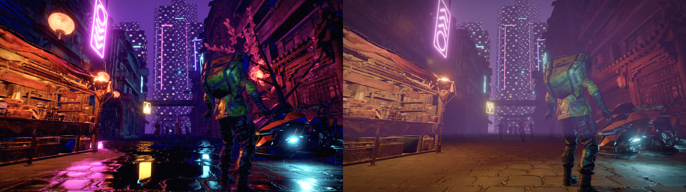

# engine-bench

One hero scene, rebuilt in two WebGPU engines and measured in Chrome on one
Mac: **Origin Engine 0.9.0** (the scene as it is, built by the released
engine through the og launcher) and **three.js r187 `WebGPURenderer`**. The
same models and textures, camera path, lights and resolution; measured
values only.

On this Mac, in Chrome's WebGPU backend, three.js's build is 36% smaller to
download (47.9 MB vs. 74.9 MB brotli), reaches its first frame about 9x
faster (1.0 s vs. 9.3 s), and runs the camera path about twice as fast per
frame (43 ms vs. 87 ms median, 54 ms vs. 233 ms p95) — while drawing less of
the scene (no rain, wet street, particles or tree; see Feature differences).
Full numbers and raw data below.

## The scene: Night Shift

origin-engine's hero showcases are The Last Light (a cliff path, a
lighthouse, sunset over the sea) and Night Shift (a courier and a
hover-bike in a neon market alley, at night, in the rain).

The Last Light looks a little better, but most of its frame is engine
systems three.js does not ship: a 1025² heightfield terrain with splatted
layers, GPU grass and five scattered plant layers, an endless wave-simulated
sea, volumetric clouds (96 steps), a physical sky and a simulated cloak. A
three.js rebuild would leave those out (not fake them), so it would draw a
small part of the same work and its frame time would say little.

**Night Shift** is the one picked. It looks nearly as good and stresses the
renderer more where both engines have the features: about 1.22 million
triangles in ten models (one courier at 123k, the bike at 151k, three
tenement blocks of each kind at about 100k), 15 dynamic lights (6 rect area
lights, 7 point lights, a shadowed spot and two cascaded directional lights),
screen-space reflections, ambient occlusion, lit volumetric fog, bloom,
eight skinned and animated walkers, and 4x MSAA at 2560 x 1440.

Two things changed in the Origin copy (`origin/night-shift`, see its
README). First, Night Shift's HUD and its font pack are removed. This is a
UI-only change: the HUD is a 2D overlay (a minimap, a timer, a quest
tracker), nothing in the 3D scene uses it, and the three.js page has no UI
either. It was needed because on the 0.9.0 web host a game whose cooked
bundle carries the `fonts/latin` font pack never draws its first frame in
Chrome. With the HUD, `start` throws that the font "is still being
fetched"; without the HUD, the frame waits forever. The Last Light hits the
same bug. It is fixed in origin-engine after 0.9.0: pending font faces are
tracked in `fonts_pending` (477c28851). Second, the camera flies the
benchmark's path.

## What each engine draws

The three.js page (`three/src/main.ts`) is the game's own code
(`set.ts`, `cast.ts`, `air.ts` and the look) rewritten with the same numbers.
It uses what three.js ships, its core and official addons, configured to the
game's values. Where three.js has no equivalent of a feature, the feature is
left out and listed here.

| Feature the scene uses | Origin Engine 0.9.0 | three.js r187 WebGPURenderer |
|---|---|---|
| 10 models, 1.22 M triangles at full detail | cooked into 3 levels of detail each; a level is drawn while its error is under a pixel | full meshes (glTF has no levels; three.js makes none) |
| Textures | cooked to KTX2/Basis (ETC1S 128 colour, UASTC+RDO+zstd data, mips), transcoded at load | the same encodings from the same sources (KTX-Software 4.4.2), transcoded at load |
| Moon: directional light, 3 shadow cascades over 200 m, 2048 maps | yes | yes (`CSMShadowNode`, 3 cascades, 2048 maps) |
| Dawn sun: directional light at intensity 0 with shadow cascades | yes | yes, as above |
| Stall spill: spot light with a 512 shadow map | yes | yes |
| 6 rect area lights (5 signs, the stall's strip) | yes (LTC) | yes (`RectAreaLight`, LTC) |
| 7 point lights (5 lanterns, the pack, the bike's underglow) | yes | yes |
| Sky: gradient (zenith, horizon, ground) and image-based ambient at 0.25 | og.Sky | the same colours as a TSL background gradient, and an environment map of it at 0.25 |
| Fog: exponential distance fog and height fog | yes | distance fog as a TSL fog node; the height fog is in the lit volume |
| Volumetric fog lit by the local lights (60 m, scattering 0.6, anisotropy 0.6) | froxel grid (64 slices) or a 24-step raymarch | `VolumeNodeMaterial` box over the alley: 24-step raymarch at quarter resolution, blurred; three.js's model has no phase function, ties the fog's extinction to the light it receives and scales by 0.01, so the same coefficients read as a thicker haze |
| Ambient occlusion on the ambient light only (0.6 m) | SSAO, full resolution | GTAO from a depth and normal prepass, full resolution, through `builtinAOContext` |
| Screen-space reflections (60 m) | stochastic, denoised, hierarchical, half resolution | `SSRNode`, half resolution |
| Bloom (0.4, threshold 1.1, knee 0.5) | yes | `BloomNode` (0.4, threshold 1.1, smooth width 0.5) |
| AgX tone mapping, exposure 1 | yes | yes |
| Grade: saturation +0.2, vignette 0.3, chromatic aberration 0.5 px, film grain 0.03 | yes | TSL `saturation`, a vignette, `ChromaticAberrationNode`, `FilmNode` |
| Antialiasing: 4x MSAA | yes | yes, on the scene pass |
| Courier: posed from his idle clip | on the CPU | `SkinnedMesh` and `AnimationMixer`, skinned on the GPU |
| 8 walkers with walk and stand clips | a GPU crowd (og.CrowdAnimation) | 8 `SkinnedMesh` instances with `AnimationMixer` |
| **Rain** (og.Weather) | yes | **not drawn**: three.js has no weather or rain system |
| **Wet street**: puddles, soaked materials, ripples (og.WeatherState, material weathering) | yes | **not drawn**: no wetness model |
| **Particles**: steam from the stall's two pots, spring petals from the tree | og.ParticleSystem | **not drawn**: three.js has no particle system |
| **The cherry tree** (a procedural `plant` model, swaying in the wind) | yes | **not drawn**: og 0.9.0 has no glTF export of a generated plant, so there is nothing to load |
| Simulation | fixed 60 Hz tick; slow frames slow the simulation down (the path then takes longer than 20 s of wall time) | the path follows the page's clock (20 s of wall time) |

So the three.js frame has less to do than Origin's: no rain, no wet street,
no particles, no tree, and no weathering in the materials. It also has more
in places: full-detail meshes, and the GTAO depth and normal prepass.

## Results

One cold run per engine, recorded 2026-11-19, canvas 2560 x 1440. Neither
run was disturbed (`results/2026-11-19/summary.md` has the full figures,
including load average and GPU share during each run).

| Engine | Download (brotli) | Cold first frame | Frame time median | Frame time p95 | Frames on the path | Path wall time |
|---|---|---|---|---|---|---|
| Origin Engine 0.9.0 | 74.90 MB (124 requests) | 9334 ms | 87.2 ms | 232.6 ms | 438 | 44.2 s |
| three.js r187 WebGPURenderer | 47.94 MB (25 requests) | 1046 ms | 43.3 ms | 53.8 ms | 452 | 20.0 s |

Origin's path wall time is longer than its nominal 20 s because its
simulation runs a fixed 60 Hz tick: when a frame is slow, the tick (and so
the path) falls behind wall time rather than skipping simulation steps
(see Method, Camera path). three.js's path follows the page's own clock, so
it always takes 20 s regardless of frame rate; its frame-time figures over
that fixed window are directly comparable to Origin's per-frame figures,
but the two "path wall time" numbers are not comparable to each other.

The same frame from each engine (the cover shot, the camera path's last
frame), Origin Engine left, three.js right:



## Method

- **Machine**: MacBook Pro (Mac16,8), Apple M4 Pro (12-core CPU, 16-core
  GPU), 24 GB, macOS 27.2 (26B5091g), on AC power. The Mac is shared with
  other work (other agents' builds and browser tests come and go), and a few
  processes stayed busy on it for days, about 2.5 of its 12 cores: a Grok
  Bot helper and `fseventsd` at a full core each and a long-running og
  native run at a third. These could not be stopped for the benchmark.
  Before each run the harness waits until the one-minute load average has
  stayed under 5 for a minute (`QUIET_LOAD`), records the load and the
  busiest processes, and samples the load every second while Chrome runs
  (`run.json`, `machine`). A run during which the load went past 10 is
  marked disturbed and repeated, its files kept as `<engine>-disturbed-<n>`.
  The CPU load average does not see work done only on the GPU (a native
  game window, a Safari WebGPU test), so the harness also reads each
  process's GPU time from `IOAccelerator`/`AGXDeviceUserClient`
  (`ioreg`) before and during the run (`machine.gpuShareBefore`,
  `gpuShareDuringRun`, seconds of GPU time per second); a run where some
  process other than Chrome gained more than 0.1 s/s of GPU time during the
  run than it already held before it (`DISTURBED_GPU`) is marked disturbed.
  One process on this Mac, WeChat's `XPlayer` helper, draws a steady
  background GPU load (observed 0.4-0.8 s/s, varying with window/compositor
  activity rather than with this benchmark) that is not a real intrusion;
  it is excluded from the check by name, same as Chrome and `WindowServer`.
  Two runs were discarded for a genuine GPU intrusion: a native build of
  the same scene running in another thread's desktop-shell test pinned the
  GPU during an Origin run (kept as `.work/discarded/`, not committed).
- **Browser**: Google Chrome 157.0.8103.79 (the installed Chrome, WebGPU on
  Metal), headed, started by the harness with a new empty profile for every
  run (`--user-data-dir` in a temporary directory) and no extensions, sync,
  component updates or background networking. The page is 1280 x 720 CSS
  pixels at a device pixel ratio of 2: both canvases are 2560 x 1440 (the
  harness reads the size of every frame's canvas texture).
- **Serving**: `harness/serve.ts` serves each build from 127.0.0.1 as a
  production host would: every file brotli-encoded at quality 11 (encoded
  before the run starts), cross-origin isolated (COOP/COEP, which Origin's
  multithreaded engine uses and three.js does not need), `Cache-Control:
  max-age=3600`.
- **Download size**: the sum of the brotli bytes the server sent for every
  request the page made, from navigation to the end of the run (the
  server's own log, `requests.json`). Origin's page is og's publish build
  (`dist/`); three.js's is a production vite build with the exported glTF
  and KTX2 files and the Basis transcoder.
- **Cold first frame**: from navigation (`performance.timeOrigin`) to the
  moment the GPU finished the page's first full frame. Each page marks its
  first full frame: Origin's shell marks `og:first-frame` (the engine's
  first frame with its pipelines made, when its splash lifts); the three.js
  page marks `bench:first-frame` after its first render, after everything
  has loaded. `harness/hook.js`, injected into the page and every Worker
  before their scripts, timestamps every canvas frame
  (`GPUCanvasContext.getCurrentTexture`) and, until the path starts, when
  the GPU finished it (`queue.onSubmittedWorkDone` after each submit). The
  reported time is the GPU completion of the last frame taken before the
  mark. `run.json` also has the first canvas frame with any content.
- **Frame time**: the interval between consecutive canvas frames
  (`getCurrentTexture` in the context that draws: Origin's engine Worker,
  three.js's page) while the camera flies the path, median and 95th
  percentile. Chrome's frame rate is not unlocked (no vsync or frame-rate
  flags); both engines stay well above the display's refresh interval.
- **Camera path**: `origin/night-shift/src/camera-path.ts`, 20 seconds of a
  Catmull-Rom spline through six keys, from the showcase's cover shot down
  the alley, up at the towers, round the courier and back to the cover shot.
  Both engines import the same file. The run waits 5 s after the first
  frame, then starts the path: Origin's play gate is clicked (the game's
  simulation starts at tick 0) and the three.js page's `__benchStart()` is
  called. The path ends when the engine's own clock reaches 20 s
  (Origin's tick / 60, three.js's page clock).
- **Runs**: one recorded run per engine, repeated only when disturbed (see
  Machine). Each recorded run is the engine's second load of its build:
  macOS keeps compiled Metal shaders in a cache outside Chrome's profile,
  shared by every Chrome, so `run-all.sh` loads each page once to its first
  frame (`--warmup`, nothing recorded) before the recorded run. The Chrome
  profile is new for every load, so Chrome's own caches (HTTP, its GPU
  shader cache) are cold; the OS's Metal cache holds both engines' shaders.

Everything a run measured is kept in `results/<date>/<engine>/`:
`run.json` (every value above, the machine, Chrome's flags and console),
`requests.json` (every request and its bytes), `frames.json` (every frame's
timestamp, size and GPU completion), `first-frame.png` (taken right after
the first full frame) and `cover.png` (the path's last frame).

## Versions

| | |
|---|---|
| Origin Engine | 0.9.0 (release, revision 820169a8), installed by the og launcher 1 from origingame.ai; `og build --publish` |
| Scene source | origin-engine `showcase/night-shift` at 49bac45d1e (main), assets pinned by sha256 in `origin/night-shift/og-assets.json` |
| three.js | 0.187.0 (r187), `three/webgpu` |
| Vite | 8.3.8 |
| glTF Transform | 4.5.1 (`@gltf-transform/cli`, `core`, `extensions`), meshoptimizer 1.3.0 |
| KTX-Software | 4.4.2 (`ktx`) |
| Bun | 1.4.4 |
| Chrome | 157.0.8103.79 (arm64) |
| macOS | 27.2 (26B5091g) |

## Rerun

```sh
scripts/run-all.sh                  # setup, both builds, one run per engine, the summary
SKIP_BUILD=1 scripts/run-all.sh     # measure the existing builds again
ENGINES=three SKIP_BUILD=1 scripts/run-all.sh results/<dir>   # one engine into a results directory
```

`scripts/setup.sh` puts everything it installs under `.tools/`: the og
launcher (`ORIGIN_HOME`) and engine cache (`ORIGIN_ENGINE_CACHE`),
KTX-Software, the bun packages, and the scene's binary assets from the
OriginGame asset store (`scripts/fetch-assets.ts`). It needs macOS on Apple
silicon, Bun, ImageMagick (`magick`, for the side-by-side image) and
Google Chrome (`CHROME=<path>` names another binary).

## Layout

| Path | What |
|---|---|
| `origin/night-shift/` | The Origin game: the showcase with the two changes above |
| `three/` | The three.js page (`src/main.ts`) and its vite config |
| `scripts/export-content.sh` | The glTF/KTX2 export the three.js page loads |
| `harness/serve.ts`, `harness/run.ts`, `harness/hook.js` | The server, one measured run, the frame hook |
| `harness/report.ts` | `summary.md` and the side-by-side image of a results directory |
| `results/` | The runs |

## Licences

The harness and the three.js page are the repository's. The Night Shift game
code comes from origin-engine. Its models and generated images were made for
origin-engine through the OriginGame gateway; the cobblestone and concrete
textures are Poly Haven's (CC0). three.js is MIT.
