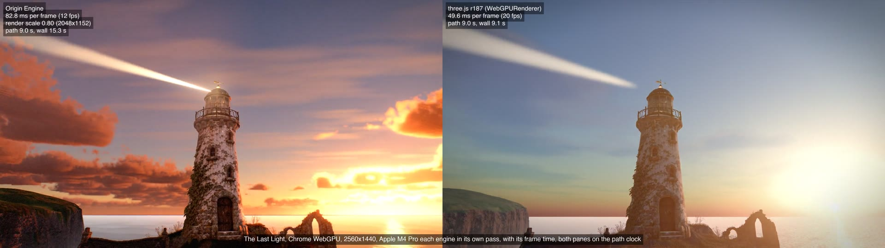

# engine-bench

One hero scene, rebuilt in two WebGPU engines and measured in Chrome on one
Mac: **Origin Engine** (the scene as it ships, built by an engine compiled
from origin-engine main at
[`3cdf5081e5`](https://github.com/originai-game/origin-engine/commit/3cdf5081e5177e31cecb1cd1a8d5079ddac74f95))
and **three.js r187 `WebGPURenderer`**. Same models, textures, ground, camera
path, lights and resolution; each engine at its own defaults. Measured
values only.

The current scene is **The Last Light** (2026-11-20). The earlier Night
Shift results (2026-11-19, Origin 0.9.0) are kept below under Earlier runs.

## The video

Both engines running the same 20-second camera path live at 2560 x 1440 on
an Apple M4 Pro, in Chrome's WebGPU backend, each in its own pass with the
GPU to itself: the wanderer's idle clip, the cloak, the lantern, the
turning beam, the sea, and the grass and plants in the wind. Each pane
carries its engine's frame time over the last second, Origin's render
scale, and where it is on the path and on the wall clock.

[](results/2026-11-20/video/side-by-side.mp4)

- [`side-by-side.mp4`](results/2026-11-20/video/side-by-side.mp4): on the
  path's clock. At path time *t* each pane shows the frame its engine had
  presented when its own clock reached *t*, so both show the same view
  throughout. Origin's pane shows fewer distinct frames, as many as it drew.
- [`side-by-side-realtime.mp4`](results/2026-11-20/video/side-by-side-realtime.mp4):
  on the wall clock, what a player saw. Origin's path takes longer than 20 s
  (see Results); three.js's pane holds its last frame.

The video passes ran under screen capture (`--video`), which costs both
engines some time; the numbers in the table come from separate runs that
capture nothing.

## Results

One cold run per engine, recorded 2026-11-20, canvas 2560 x 1440 (CSS
1280 x 720 at device pixel ratio 2). Neither run was disturbed
([`results/2026-11-20/summary.md`](results/2026-11-20/summary.md) has the
full figures, the load during each run and the raw values).

| Engine | Download (brotli) | Cold first frame | Frame time median | Frame time p95 | Frames on the path | Path wall time |
|---|---|---|---|---|---|---|
| Origin Engine (main 3cdf5081e) | 53.24 MB (100 requests) | 5149 ms | 99.7 ms | 213.8 ms | 377 | 37.4 s |
| three.js r187 WebGPURenderer | 43.75 MB (27 requests) | 4008 ms | 38.6 ms | 97.5 ms | 361 | 20.1 s |

**What Origin drew at.** Origin's default is automatic quality: it lowers
the render scale while frames run over the frame cap's interval (60 Hz,
16.7 ms) and raises it when there is room. It drew the frame at a lower
resolution for half the path; TAA upscaled it to the canvas. The three.js
page has no such mechanism and always draws 2560 x 1440 with 4x MSAA.

Origin Engine (main 3cdf5081e)'s render scale over the path (automatic quality, its default; the path's own clock): 1.0 from 0.0 s, 0.9 from 4.4 s, 0.8 from 7.2 s, 0.7 from 9.8 s, 0.6 from 12.6 s, 0.5 from 15.0 s, 0.5 and the graphics preset 1 step down from 18.7 s. Lowest 0.5; below 0.75 for 10.2 s of the 20 s path (51%). Every step is in frames.json (`display`).

On this page Origin does not get back under its budget at any scale, so
automatic quality steps down every ~50 frames to its floor (0.5) and then
one graphics preset step, and never back up. Below a scale of 0.8 the
frame time stopped falling (median interval per rung: 1.0 119.5 ms, 0.9
100.6, 0.8 82.4, 0.7 85.6, 0.6 91.9, 0.5 100.4 ms; later rungs also see more
of the sea), so the lower rungs cost image quality without saving time.
That is a finding about the engine, reported to origin-engine; the
benchmark records what it did rather than pinning a scale.

**Why Origin's path takes 37 s of wall time.** Origin's simulation runs a
fixed 60 Hz tick and catches up at most 4 ticks per drawn frame
(`maxCatchUpTicks`). A frame that takes longer than 4 x 16.7 = 66.7 ms
leaves the simulation behind the wall clock, so at Origin's ~100 ms per
frame its 20 s path ran at about 0.55x real time. three.js's page follows
its own clock (20.1 s). The frame-time figures are comparable; the two path
wall times are not.

The cover shot (the path's last frame), Origin left, three.js right:


## The scene: The Last Light

origin-engine's hero showcase A (`showcase/the-last-light`): a cloaked
wanderer with a staff and lantern on a cliff path, a stone lighthouse
sweeping its beam through the sea mist, the sun going down into a swelling
sea. Clear weather, summer, sunset. Most of its frame is engine systems:
a 1025² heightfield terrain (480 m) with four layered materials, GPU grass
(700 blades a square metre to 120 m), five scattered plant layers, an
endless FFT sea with shoaling, foam and spray, ray-marched volumetric
clouds (96 steps), a physical sky with automatic exposure, a simulated
cloak and lantern cord, a shadowed lantern light, a spot-lit beam in a fog
volume, height fog, god rays, AO, bloom and a film grade.

It replaced Night Shift because what it draws is what a game engine adds
over a renderer; the three.js port rebuilds as much of it by hand as
three.js allows, and lists the rest (What each engine draws, Feature
differences).

The Origin copy (`origin/the-last-light`) is the showcase as on main with
two additions: the camera flies the benchmark's path
(`src/camera-path.ts`, shared with the three.js page), and `src/bench.ts`
reads switches the harness sets for the feature measurements only
(a held path time, features off, automatic quality pinned off at scale 1).
A normal run sets none of them. The harness suppresses the shell's
"Install to play offline" banner on both pages.

## What each engine draws

The three.js page (`three/src/the-last-light.ts`) is the game's own code
(`coast.ts`, `lighthouse.ts`, `sky.ts`, `wanderer.ts`, `climate.ts` and the
look) rewritten with the same numbers, on the same content exported once
as glTF, KTX2 and raw samples (`scripts/export-content.sh`; the plants and
the staff come from `og export gltf`). It uses what three.js ships, its
core and official addons, configured to the game's values. Where three.js
has no equivalent, the page draws the feature by hand and says so, or
leaves it out and lists it.

| Feature | Origin Engine | three.js r187 |
|---|---|---|
| Models (lighthouse, cottage, ruin, rocks, wanderer, lantern) | cooked, levels of detail | the same glTFs, full detail |
| Terrain: 1025² heights, 4 layers by weight, height-blended, triplanar rocks, anti-tiling | og.Terrain | **hand-written**: a mesh from the raw heights and a TSL material with the same layers and rules |
| Grass: 700 a square metre to 120 m, 3 levels of detail, wind | og.Grass, generated on the GPU each frame | **hand-written**: og.Grass's scheme (blue-noise tiles, distance table, 2^21-blade budget over the chunks in view) as an `InstancedMesh` per 16 m chunk |
| Five plant layers (plume grass, oxeye, buttercup, thrift, foxglove) | og.TerrainScatter, placed and culled on the GPU | **hand-written**: og.TerrainScatter's placement rules on the CPU at load, `InstancedMesh` per 16 m chunk, Origin's sway in the vertex shader |
| Hawthorn (37k triangles), staff | generated `plant` models | the same, from `og export gltf`, season tint as a material colour |
| Sea: endless, FFT, shoaling, shore foam, spray, foam streaks, reflections and refraction | og.Water | **hand-written**: four Gerstner waves on a grid that follows the camera, depth colour and shore foam, the sky's light as its reflection |
| Sky | og.PhysicalSky (Hillaire 2020) | `SkyMesh` (Preetham 1999 analytic) and a PMREM of it |
| Clouds | og.Clouds, ray-marched volume, 96 steps | `SkyMesh`'s flat cloud layer |
| Sun: shadow cascades over 160 m | yes | `CSMShadowNode`, 3 cascades, 2048 maps |
| Lantern: shadowed point light | yes | `PointLight`, 512 shadow map |
| The beam: spot light (120000, 420 m, angle 0.06) in a fog volume (density 0.008) | og.SpotLight in og.FogVolume, Henyey–Greenstein phase 0.6 | `SpotLight` in a `VolumeNodeMaterial` box at quarter resolution, with og.Fog's phase written in |
| Height fog | og.Fog | **hand-written**: the analytic integral as a TSL fog node |
| God rays (48 taps, threshold 2) | yes | **hand-written**: Origin's mask, blur and 4x4 resolve |
| AO, bloom, chromatic aberration, film grain, vignette, AgX | yes | `GTAONode`, `BloomNode`, `ChromaticAberrationNode`, `FilmNode`, TSL |
| Exposure | automatic (metered, adapting) | fixed at 2 (the brightness Origin settles at on the cover) |
| Antialiasing | TAA (default) | 4x MSAA (default) |
| Wanderer: idle clip | GPU skinning | `SkinnedMesh`, `AnimationMixer` |
| Wanderer: hand on the staff | og.IkChain | **hand-written**: analytic two-bone IK |
| The cloak | og.Garment, simulated in the wind | **not possible**: the skinned cloak as the clip poses it |
| The lantern cord | og.Rope | a still cylinder |
| Leaves and petals lit from behind (glTF diffuse transmission) | yes | three.js ignores `KHR_materials_diffuse_transmission`; a hand-written back-light term stands in |
| Resolution | automatic quality (see Results) | the canvas's |
| Simulation | fixed 60 Hz tick, at most 4 catch-up ticks a frame | the page's clock |

"Hand-written" parts are code in the benchmark repository, not shipped
three.js. A three.js user would have to write them as well.

**What three.js cannot match** (left as is, not imitated):
- The sky: Preetham's analytic model goes blue at sunset and draws a wide
  white Mie glare around a low sun, where Origin's physical sky is warm.
- Volumetric clouds: three.js has none; `SkyMesh`'s cloud layer is 2D.
- Cloth: three.js has no cloth simulation.
- Automatic exposure: three.js has no exposure meter.
- Foliage translucency: three.js ignores the glTF's diffuse transmission;
  the plume grass heads read as flat sprigs where Origin lights them
  through. The exported plume grass mesh, drawn in a separate viewer with no
  wind, has the same sideways heads, so the difference is in the shading.
- The beam's first few metres at the lamp, where the cone is under a metre
  wide, are below what three.js's quarter-resolution volume pass resolves.
- The sea's spray and foam streaks.

## Feature differences

**Status, 2026-11-20: the three.js page is frozen as it is.** The
benchmark's effort has moved to optimising Origin; the three.js port gets
no further fixes, and the per-feature crop pairs and costs on the web
(`scripts/features.sh`, `harness/features-report.ts`) have not been run
for this results directory. The table under What each engine draws lists
every difference and how three.js got there.

What the features cost Origin, measured natively instead (`og run --trace`,
Metal on the same M4 Pro, 2560 x 1440 at render scale 1, path 15 to 17 s,
the median GPU time per frame with one bench switch off at a time; the
base frame took 90.7 ms of GPU time):

| Switched off | GPU ms saved per frame |
|---|---|
| The sea (og.Water) | 24.2 |
| Grass (og.Grass) | 11.4 |
| The five plant layers (og.TerrainScatter) | 9.9 |
| Volumetric clouds (og.Clouds) | 4.1 |
| Physical sky (og.PhysicalSky) | 2.0 |

In Chrome the sea costs more than natively (about 58 ms of a 129 ms frame
at path 16 s); that gap is being worked on in origin-engine.

## Method

- **Machine**: MacBook Pro (Mac16,8), Apple M4 Pro (12-core CPU, 16-core
  GPU), 24 GB, macOS 27.2 (26B5091g), on AC power. The Mac is shared with
  other work. Before each run the harness waits until the one-minute load
  average has stayed under 5 (`QUIET_LOAD`) and the GPU's utilization
  under `QUIET_GPU` for a minute, records the load and the busiest
  processes, and samples the load every second while Chrome runs
  (`run.json`, `machine`). These runs used `QUIET_GPU=40`: the utilization
  reading on this Mac jumps to about 90% for a while after the harness's
  previous Chrome closes, with no process drawing on the GPU, and the
  default of 10 waited on that indefinitely. A run during which the load
  went past 10, or a process other than Chrome gained more than 0.1 s/s of
  GPU time (`ioreg`, `AGXDeviceUserClient`), is marked disturbed and
  repeated, its files kept as `<engine>-disturbed-<n>`.
- **Browser**: Google Chrome 158.0.8127.36 (WebGPU on Metal), headed, a new
  empty profile for every run, no extensions, sync, component updates or
  background networking. The page is 1280 x 720 CSS pixels at a device
  pixel ratio of 2: both canvases are 2560 x 1440.
- **Serving**: `harness/serve.ts` serves each build from 127.0.0.1 as a
  production host would: brotli at quality 11, cross-origin isolated
  (COOP/COEP), `Cache-Control: max-age=3600`.
- **Download size**: the brotli bytes the server sent for every request the
  page made, from navigation to the end of the run (`requests.json`).
- **Cold first frame**: from navigation to the GPU finishing the page's
  first full frame. Origin's shell marks `og:first-frame` (the engine's
  first frame with its pipelines made); the three.js page marks
  `bench:first-frame` after its first render. `harness/hook.js` timestamps
  every canvas frame and its GPU completion in the page and every Worker.
- **Frame time**: the interval between consecutive canvas frames while the
  camera flies the path, median and 95th percentile. No vsync or frame-rate
  flags.
- **Render scale**: Origin's own record of what automatic quality chose,
  one row per change (`frames.json`, `display`), summarised in `run.json`
  (`frameTime.drawnAt` by wall time, `frameTime.scaleTrace` by path time).
- **Camera path**: `origin/the-last-light/src/camera-path.ts`, 20 seconds of
  a Catmull-Rom spline through six keys: from the cover shot down the cliff
  path, over the cottage, out over the sea past the stacks, round behind the
  wanderer and back to the cover shot. Both engines import the same file.
  The run waits 5 s after the first frame, then starts the path. The path
  ends when the engine's own clock reaches 20 s (Origin's tick / 60,
  three.js's page clock).
- **Runs**: one recorded run per engine, repeated only when disturbed. Each
  recorded run is the engine's second load of its build (`run-all.sh` loads
  each page once first): macOS keeps compiled Metal shaders in a cache
  shared by every Chrome. Chrome's own caches are new for every load.
- **Video**: `scripts/video.sh` runs one pass per engine with Chrome's
  screencast (`--video`) and `harness/video.ts` composes the two at 30 fps.

Everything a run measured is kept in `results/<date>/<engine>/`:
`run.json`, `requests.json`, `frames.json`, `first-frame.png` and
`cover.png`. The video passes keep the same files beside their mp4s; the
captured frames themselves are not committed.

## Earlier runs

**Night Shift, 2026-11-19** (Origin Engine 0.9.0 release; a neon market
alley at night in the rain, 1.22 M triangles, 15 dynamic lights, SSR,
volumetric fog). Its README section, table and raw data are in
[`results/2026-11-19/`](results/2026-11-19/summary.md):

| Engine | Download (brotli) | Cold first frame | Frame time median | Frame time p95 |
|---|---|---|---|---|
| Origin Engine 0.9.0 | 74.90 MB | 9334 ms | 87.2 ms | 232.6 ms |
| three.js r187 | 47.94 MB | 1046 ms | 43.3 ms | 53.8 ms |

On 0.9.0 the bench copy had to drop Night Shift's HUD and font pack: a
cooked font pack hung the first frame on the web host. That is fixed on
origin-engine main (83db3c24a).

**Night Shift video, 2026-11-20**: the same side-by-side for Night Shift's
path, Origin built from main 3cdf5081e5, in
[`results/2026-11-20/video-night-shift/`](results/2026-11-20/video-night-shift/side-by-side.mp4).
Under capture: Origin median 74.9 ms (p95 313 ms), three.js 32.4 ms.

## Versions

| | |
|---|---|
| Origin Engine | built from origin-engine main [`3cdf5081e5`](https://github.com/originai-game/origin-engine/commit/3cdf5081e5177e31cecb1cd1a8d5079ddac74f95) (`og build --publish`; the build still reports version 0.9.0) |
| Scene source | origin-engine `showcase/the-last-light`, assets pinned by sha256 in `origin/the-last-light/og-assets.json` |
| three.js | 0.187.0 (r187), `three/webgpu` |
| glTF Transform | 4.5.1, meshoptimizer 1.3.0 |
| KTX-Software | 4.4.2 (`ktx`) |
| Bun | 1.4.4 |
| Chrome | 158.0.8127.36 (arm64) |
| macOS | 27.2 (26B5091g) |

## Rerun

```sh
scripts/run-all.sh                  # setup, both builds, one run per engine, the summary
SKIP_BUILD=1 scripts/run-all.sh     # measure the existing builds again
scripts/features.sh results/<dir>   # the feature section's costs and crops
scripts/video.sh results/<dir>      # the side-by-side videos
OG_ENGINE_PACKAGE=<origin-engine>/packages/engine scripts/build.sh   # build Origin's page with an engine built from source
```

`scripts/setup.sh` puts everything it installs under `.tools/`: the og
launcher and engine cache, KTX-Software, the bun packages, and the scene's
binary assets from the OriginGame asset store. It needs macOS on Apple
silicon, Bun, ImageMagick, ffmpeg and Google Chrome (`CHROME=<path>` names
another binary).

## Layout

| Path | What |
|---|---|
| `origin/the-last-light/` | The Origin game: the showcase with the camera path and the bench switches |
| `origin/night-shift/` | The earlier scene's Origin game |
| `three/` | The three.js pages (`src/the-last-light.ts`, `src/night-shift.ts`) and the vite config |
| `scripts/export-content.sh` | The glTF/KTX2 export the three.js page loads |
| `harness/serve.ts`, `harness/run.ts`, `harness/hook.js` | The server, one measured run, the frame hook |
| `harness/report.ts`, `harness/features-report.ts`, `harness/video.ts` | `summary.md`, the feature section, the videos |
| `results/` | The runs |

## Licences

The harness and the three.js pages are the repository's. The game code
comes from origin-engine. Its models and generated images were made for
origin-engine through the OriginGame gateway; the terrain and rock
textures are Poly Haven's (CC0). three.js is MIT.
