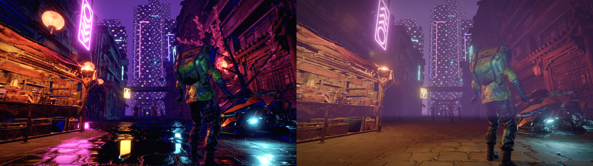

# Night Shift in Chrome (WebGPU): 2026-11-19

Mac16,8, Apple M4 Pro, macOS 27.2 26B5091g; Chrome/157.0.8103.79; canvas 2560 x 1440. One cold run per engine.

| Engine | Download (brotli) | Cold first frame | Frame time median | Frame time p95 | Frames on the path | Path wall time |
|---|---|---|---|---|---|---|
| Origin Engine 0.9.0 | 74.90 MB (124 requests) | 9334 ms | 87.2 ms | 232.6 ms | 438 | 44.2 s |
| three.js r187 WebGPURenderer | 47.94 MB (25 requests) | 1046 ms | 43.3 ms | 53.8 ms | 452 | 20.0 s |

| Engine | First canvas frame (any content) | Page's first-frame mark | Frames drawn before the first full one | Mean frame time | Longest frame |
|---|---|---|---|---|---|
| Origin Engine 0.9.0 | 3431 ms | 5221 ms | 24 | 100.9 ms | 555.0 ms |
| three.js r187 WebGPURenderer | 1046 ms | 939 ms | 0 | 44.2 ms | 59.6 ms |

Load average (1, 5, 15 min) when each run started, and the highest one-minute load while it ran: origin { 3.54 3.68 6.01 }, at most 5.39; three { 2.83 3.64 5.66 }, at most 3.03.
No run was disturbed.

